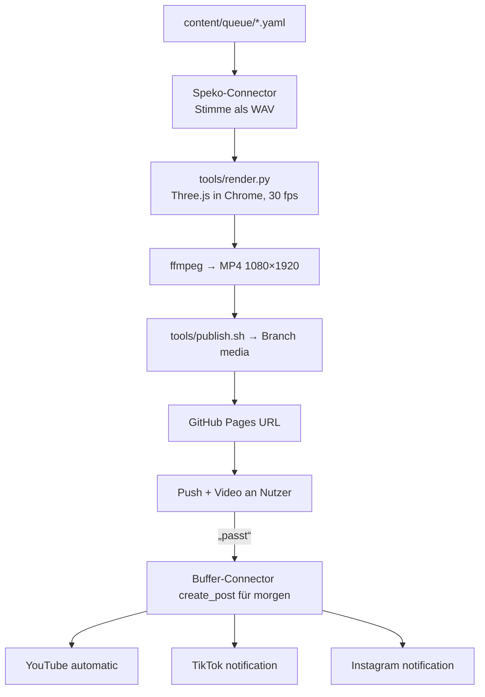

# 4 · Architektur

## Täglicher Ablauf (alles in Claudes Umgebung, ausgelöst von geplanten Claude-Aufgaben)

Details: `docs/07_CLAUDE_ABLAUF.md`. GitHub Actions (`tools.yml`, `src/`) sind nur noch ein optionaler Notfall-Weg.

## Dateien

| Datei | Aufgabe |
|---|---|
| `src/lib/config.mjs` | Settings laden, Zeitzonen-Umrechnung, Posting-Fenster-Prüfung |
| `src/lib/speko.mjs` | Text → MP3 via Speko + geschätzte Wort-Timings (für Untertitel) |
| `src/lib/render.mjs` | lokaler Mini-Webserver + Puppeteer + ffmpeg |
| `renderer/runtime.js` | im Browser: Three.js-Setup, Untertitel, Hook-Text, `__frame(t)` |
| `renderer/scenes/*.js` | eine Datei pro Szenen-Typ |
| `src/lib/buffer.mjs` | Buffer GraphQL (`createPost`, Kanäle) |
| `src/produce.mjs` | Schritt 1: Videos bauen → `out/manifest.json` |
| `src/schedule.mjs` | Alternative ohne Freigabe (direkt per API einplanen) – aktuell **nicht** in Benutzung |
| `src/tools.mjs` | `channels`, `voice-test`, `plan` |

## Designentscheidungen
- **Deterministisches Rendern:** kein `requestAnimationFrame`; Node ruft `__frame(t)` pro Frame auf und macht einen Screenshot. Ergebnis ist unabhängig von der Rechenleistung des Runners (der rendert per Software-GL/SwiftShader – langsam, aber zuverlässig; ca. 2–5 Min. pro 30-s-Video).
- **Untertitel als HTML-Overlay** über dem WebGL-Canvas (darum Screenshot statt `canvas.toDataURL`).
- **Media-Branch wird jedes Mal neu geschrieben** (orphan + force-push) → das Repo wächst nicht mit jedem Video.
- **Nur der aktuelle Tag wird eingeplant** → passt ins Buffer-Free-Limit (10 Posts/Kanal) und Buffer findet die Videos sicher noch online.
- **Buffer holt Videos erst beim Posten** → `media_keep_days: 7` als Puffer.

## Erweiterungsideen (später)
- Hintergrundmusik (lizenzfrei) per ffmpeg-Mix
- Eigene 3D-Modelle (`.glb`) in `renderer/assets/`
- Skripte automatisch per KI aus einer Themenliste erzeugen
- Fallback, wenn Queue leer ist (Benachrichtigung per GitHub-Issue)
